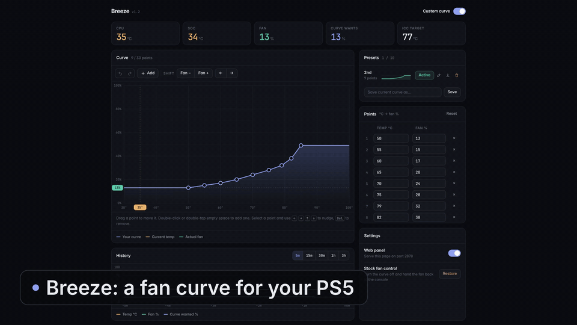

<h1 align="center">Breeze</h1>

<p align="center">
  A fan curve for your PS5, as a single payload.<br>
  Set how loud the fan gets at each temperature, from your phone or PC.
</p>

<p align="center">
  <a href="https://github.com/MiladRx/Breeze/releases/latest"></a>
  <a href="LICENSE"></a>
  
  
  
  <a href="https://github.com/ps5-payload-dev/sdk"></a>
</p>

<p align="center">
  <a href="#features">Features</a> ·
  <a href="#install">Install</a> ·
  <a href="#the-web-panel">Web panel</a> ·
  <a href="#how-it-works">How it works</a> ·
  <a href="#build">Build</a>
</p>

<p align="center">
  
</p>

---

## Features

- **Your own fan curve.** Up to 30 points, each a temperature → fan %. Breeze measures the real fan speed every second and keeps it on your curve.
- **Web panel on your LAN.** Drag points on a live chart, type exact values, undo and redo, shift the whole curve. Works on phones too.
- **Presets.** Save up to 10 curves and switch between them with one tap.
- **Live readouts.** CPU and SoC temperature, fan speed, what the curve wants, and up to 3 hours of history you can hover over.
- **Smooth, not jumpy.** Loading screens, game launches and sensor spikes are filtered, so the fan doesn't surge every time a scene loads.
- **Safe by default.** Past 88 °C Breeze always asks for maximum cooling, and when it stops it hands the fan back to the console's stock control.
- **No setup.** One ELF, no daemon or plugin framework needed. Launch it again and the new copy replaces the running one.

## Install

Breeze is a normal `ps5-payload-sdk` ELF, so any ELF loader works.

**Payload Manager (recommended)**
1. Download `breeze.elf` from the [latest release](https://github.com/MiladRx/Breeze/releases/latest).
2. In Payload Manager, choose **Upload ELF Payload** and pick the file.
3. Launch it. Add it to **Autoload** so it starts on every boot.

**elfldr directly**
```sh
nc -q0 <ps5-ip> 9021 < breeze.elf
```

On start the console shows a notification with the panel address, for example:

> Breeze running (custom curve on)<br>
> Panel: `http://<PS5-IP>:2878`

## The web panel

Open the address from the notification in any browser on the same network.

| Part | What it does |
| --- | --- |
| **Custom curve** switch | Turns Breeze's control on or off. Off means the console's stock fan behaviour. |
| **Curve** | Drag points, double-click (or double-tap) to add one, select one to nudge it with the arrow keys. The dashed lines show the current temperature and fan speed. |
| **History** | Temperature, fan speed and what the curve asked for, over 5 minutes up to 3 hours. |
| **Presets** | Load, overwrite or delete saved curves. The one running is marked **Active**. |
| **Points** | The same curve as a table, for exact values. |
| **Settings** | Turn the panel off, or hand the fan back to the console. |

Changes stay in the editor until you press **Apply** (or <kbd>Ctrl</kbd>+<kbd>S</kbd>).

## How it works

The PS5 has no "set fan to X %" switch. Its fan controller works like a thermostat: you give it a **target temperature** and it spins the fan to cool towards it. Breeze closes the loop around that:

1. Every second it reads the CPU temperature and the actual fan speed.
2. It looks up what fan speed your curve wants at that temperature.
3. It nudges the controller's target up or down until the measured fan speed matches.

The console reacts a few seconds late and in large jumps, so Breeze waits for each step to settle, ignores one-second spikes and dips, and backs off quickly if the fan overshoots.

## Known limitations

Breeze is new and has only been tested on one console, so expect some rough edges:

- **The fan readout may be a little off.** The fan speed comes from an undocumented system call, and its scale is a best guess. Treat the % as a close estimate rather than an exact RPM.
- **The fan won't always land exactly on the curve.** The console moves the fan in steps, so it can sit a few percent above or below what the curve asks for.
- **There's a minimum the console won't go below.** At a given temperature the console keeps its own minimum fan speed, so a curve below that line can't be followed.
- **Short spikes can still happen.** Right as a game launches, the fan can briefly rise for a few seconds before Breeze pulls it back.
- **The history graph resets** when Breeze restarts.

Found something off? [Open an issue](https://github.com/MiladRx/Breeze/issues) and include `/data/breeze/breeze.log` if you can.

## Files on the console

| Path | What |
| --- | --- |
| `/data/breeze/breeze.conf` | Curve, on/off, panel port, panel token |
| `/data/breeze/presets.conf` | Saved presets |
| `/data/breeze/breeze.log` | Controller log |

The history graph lives in memory and starts over when Breeze restarts.

## Build

Needs [ps5-payload-sdk](https://github.com/ps5-payload-dev/sdk), CMake and Ninja.

```sh
PS5_PAYLOAD_SDK=/path/to/ps5-payload-sdk ./build.sh   # -> build/breeze.elf
```

The panel is plain HTML in [`web/panel.html`](web/panel.html); the build embeds it into the ELF.

## Credits

Made by [**Milad** (MiladRx)](https://github.com/MiladRx).

Thanks to [John Törnblom](https://github.com/john-tornblom) for the PS5 payload SDK, and to the OnionHEN project, where the fan controller interface was first worked out.

## License

[GPL-3.0](LICENSE).

> Breeze is an unofficial homebrew project and is not affiliated with or endorsed by Sony Interactive Entertainment. It changes how your console's fan behaves: use it only on hardware you own, keep an eye on temperatures, and use it at your own risk. No warranty is provided.
